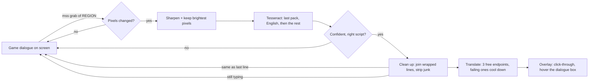

# Game Text Translator

A Windows overlay that reads the dialogue box of a game **on screen** and puts the
translation exactly where the original text was. No mods, no memory reading, no
game files touched — it works on anything that draws text.

Point it at a dialogue box once, press `Ctrl+Alt+T`, and the Japanese (or Korean,
Chinese, Russian, Thai, Arabic — any script Tesseract has a pack for) is replaced
by English in place, in a font sized to fill the box. `Ctrl+Alt+L` turns on live
mode, which re-reads the box by itself and follows the conversation.

<!-- A demo GIF belongs here. It needs a capture of a real game session. -->

## Why this is more than "screenshot → OCR → translate"

Most of the work is in the parts that make it usable while you are actually
playing:

- **It never reads its own translation.** The overlay calls
  `SetWindowDisplayAffinity(WDA_EXCLUDEFROMCAPTURE)`, so Windows leaves it out of
  screenshots. The OCR keeps seeing the game underneath, so live mode does not
  feed on itself. Older Windows gets a hide-shoot-show fallback instead.
- **Clicks pass through it.** The window is `WS_EX_LAYERED | WS_EX_TRANSPARENT`
  and top-most, so it sits over the dialogue without stealing mouse input. Move
  mode temporarily lifts that so the box can be dragged.
- **Only the letters are OCR'd.** Game dialogue is white text over a live scene.
  The capture is sharpened and thresholded to the brightest pixels, which throws
  away the background that Tesseract would otherwise read as kanji and translate
  into nonsense.
- **The right language pack wins on evidence, not on the first answer.** Each
  pack must be confident *and* produce the script it was asked for; kanji-only
  Japanese reads are held back so the Chinese packs can try to beat them. The
  pack that last succeeded is tried first, so the common case is one OCR pass.
- **It waits for the text to finish typing.** Games reveal dialogue one character
  at a time; translating a half-written line invents words. A read is only
  translated once the pixels stop changing (or a 2 s cap), so partial sentences
  never reach the screen.
- **Unchanged screens cost nothing.** The raw pixels are hashed, so a static
  dialogue box skips OCR and translation entirely.
- **It degrades instead of dying.** Translation tries three endpoints and puts a
  failing one on a cooldown (rate limits 3 min, timeouts 1 min). Answers with no
  English in them count as failures. A blank or unreadable capture says so on
  screen instead of showing garbage.

## Requirements

- **Windows 10 2004 or newer** (the screenshot-exclusion API; older versions fall
  back to the slower hide-shoot mode)
- **Python 3.10+**
- **Tesseract OCR** — `winget install UB-Mannheim.TesseractOCR`
- Run the game in **borderless windowed** mode. Exclusive fullscreen hands back
  black frames to every screen-grab API.

## Set up

```bat
winget install UB-Mannheim.TesseractOCR
pip install -r requirements.txt

python pick_region.py     :: drag a box around the dialogue text, click "Use this region"
python main.py            :: start the overlay
```

`pick_region.py` shows exactly what the OCR will see and what it read before it
writes the four numbers into `capture.py`. Re-run it whenever the game window
moves, the resolution changes, or you switch monitors.

On first start the app downloads the Japanese and English Tesseract packs into
`tessdata/` (they are not in this repo — they are tens of megabytes). The other
scripts it supports arrive in the background while the overlay is already open.

## Hotkeys

| Keys | Action |
| --- | --- |
| `Ctrl+Alt+T` | Translate the region now |
| `Ctrl+Alt+L` | Live mode on/off — follows the dialogue by itself |
| `Ctrl+Alt+M` | Move mode on/off — makes the window draggable |
| `Ctrl+Alt+D` | Show/hide the last captured crop (what the OCR actually saw) |
| `Ctrl+Alt+Q` | Quit |

Modifier combos are used because games take the plain function keys.

## How a frame flows



## Layout

| File | Responsibility |
| --- | --- |
| `main.py` | The overlay window, hotkeys, live mode, the single worker thread, error reporting |
| `capture.py` | Screenshot of the region, Tesseract configuration, language ranking, text cleanup |
| `translator.py` | The only file that talks to the network: translation with failover, OCR pack downloads |
| `pick_region.py` | One-off region picker that previews the OCR result and writes `REGION` back |

## Tuning

- `capture.REGION` — the four screen coordinates to read.
- `capture.LANGUAGE_GROUPS` / `MIN_CONFIDENCE` — which packs are tried and how
  sure Tesseract has to be.
- `main.FONT_SIZES` — the overlay picks the largest size that still fits the box.
- `translator.TARGET_LANG` — output language, `"en"` by default.

### Paid / official translation (optional)

Out of the box the app uses three free, keyless endpoints. For reliability, put a
key in `.env` next to `translator.py`:

```
GOOGLE_TRANSLATE_API_KEY=your-key-here
```

`translator.py` picks it up on start and switches to the official API. The file
also documents how to drop in Naver Papago instead — that is the only file that
would change.

## Known limits

- Windows only: the overlay relies on `user32` window styles.
- Text baked into a texture (pre-rendered UI, some 2D games) is read no better
  than by eye; stylised fonts hurt OCR accuracy.
- The free endpoints are unofficial and can rate-limit. The app warns and
  retries; the keyed API does not have that problem.
- One region at a time, on one screen position.
- Untested against anti-cheat software. It only reads pixels and draws a window,
  but that is worth knowing before you try it online.

## Licence

MIT — see [LICENSE](LICENSE).
